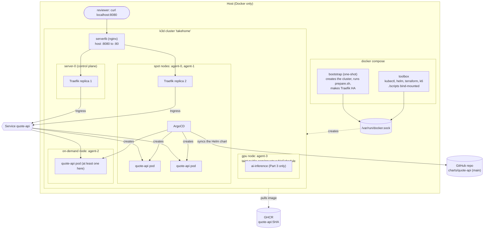

# quote-api on a local spot/on-demand Kubernetes cluster

A small Python HTTP service, deployed by ArgoCD from its own Helm chart onto a local k3d cluster that simulates spot,
on-demand and GPU nodepools. Everything runs in Docker; the only thing the host needs is Docker.

- Image: `ghcr.io/reynaldiekoz98/quote-api` (public, tagged with the git SHA, no `latest`)
- Repository: <https://github.com/reynaldiekoz98/devops-takehometest>

## Quick start

```bash
git clone https://github.com/reynaldiekoz98/devops-takehometest.git && cd devops-takehometest
docker compose up -d
./scripts/run-all.sh
```

Then, from the host:

```bash
curl http://localhost:8080/api/quote
```

### How long it takes

The best run so far, from a clean start (no cluster, images not yet pulled inside the cluster):

| Step | Time |
|---|---|
| `docker compose up -d` (cluster, nodes, Traefik) | 82 seconds |
| `./scripts/run-all.sh`: ArgoCD ready | about 2 minutes (it printed 4 progress lines, 30 s apart, then the pods were ready) |
| `./scripts/run-all.sh`: deploy, drill (84 of 84 requests succeeded) and Part 3 `verify.sh` | the rest, ending in `PASS` and `ALL DONE` |

Measured on a laptop: AMD Ryzen 7 8845HS (8 cores, 16 threads), about 20 GB of RAM, Windows with WSL2
(Ubuntu 24.04; WSL sees 16 CPUs and about 9.6 GB), Docker 29.6, on a home internet connection.

**This is the best case, and the time depends mostly on the internet speed while the images are pulled.** Every image is
downloaded from the internet inside the new cluster (k3s, Traefik, ArgoCD, nginx and the app). On a slower connection the same run has
sometimes taken 15 to 20 minutes, for example with ArgoCD alone needing about 10 minutes, so the scripts wait up to 15 minutes
per step and print a progress line every 30 seconds instead of looking frozen. A second run is much faster because the images are already on the nodes.
If a step still stops with the "download failed or too slow" message, run `./scripts/run-all.sh` again.

Needs: Docker (with Compose v2), free port 8080 (change it with `HTTP_PORT=9090 docker compose up -d`), and about
6 GB of free memory. The cluster is removed with `k3d cluster delete takehome && docker compose down -v`.

## Architecture



Request path: host `:8080` → k3d load balancer → Traefik (2 replicas) → Service → quote-api pods.
Deploy path: Git (`charts/quote-api` on `main`) → ArgoCD `Application` → pods. The app is never installed with `helm install`.

CI path (separate from the above): a pull request runs Semgrep over the repo; if the app image changed it builds the
image, scans it with Trivy, pushes it to GHCR tagged with the commit SHA, and commits the new tag into the chart.
After the merge, ArgoCD deploys that tag. See `MIGRATION-NOTES.md`.

## What is in the repository

| Path | What it is |
|---|---|
| `app/` | The service (`main.py`, standard library only) and its multi-stage, non-root Dockerfile |
| `charts/quote-api/` | The Helm chart (written from scratch): probes, requests/limits, non-root read-only rootfs, Service, Ingress, HPA (min 3), PDB, placement |
| `argocd/application.yaml.tpl` | The ArgoCD `Application` (repo URL and revision are filled in by `20-deploy.sh`) |
| `cluster/traefik-ha.yaml` | Makes the built-in Traefik run 2 replicas so a node drain cannot cut the ingress |
| `docker-compose.yml`, `toolbox/` | The harness: bootstrap job plus the toolbox container |
| `scripts/` | The numbered task scripts (below) |
| `troubleshoot/` | The provided files plus `fixed-app.yaml`: the 9 fixes, with the `default-deny` NetworkPolicy kept and three narrow allow rules added (details in `TROUBLESHOOTING.md`) |
| `.github/workflows/ci.yml` | The GitHub Actions pipeline (Part 4) |
| `TROUBLESHOOTING.md`, `MIGRATION-NOTES.md`, `OPS-ANSWERS.md`, `AI-USAGE.md` | Write-ups |

## Script reference

All scripts are idempotent. Run on the host, each one re-runs itself inside the toolbox, so nothing else is installed.

| Script | What it does | When to run it |
|---|---|---|
| `scripts/00-bootstrap.sh` | Creates the k3d cluster (1 server, 4 agents), runs `troubleshoot/prepare.sh` (spot, on-demand, GPU labels and taint), makes Traefik highly available | Started by `docker compose up -d`; run again only to repair |
| `scripts/20-deploy.sh` | Installs ArgoCD, applies the `Application`, waits until it is Synced and Healthy, shows pod placement, curls the API through the ingress | After bootstrap |
| `scripts/25-reclaim-drill.sh` | Drains one spot node while a curl loop hits the service, shows pods rescheduling and the success rate, then uncordons | After deploy; the drill for Part 2 |
| `scripts/30-troubleshoot.sh` | Applies `troubleshoot/fixed-app.yaml` and runs the provided `verify.sh` (prints PASS). `SHOW_BROKEN=1` applies the broken manifest first | After bootstrap; Part 3 |
| `scripts/run-all.sh` | Runs `20`, `25` and `30` in order | The one command the reviewer runs |
| `scripts/lib.sh` | Shared helpers: re-run inside the toolbox, `wait_ready` with progress output | Not run directly |

## Design decisions and trade-offs

- **Placement.** Required node affinity to spot or on-demand (never the GPU node), preferred weight 100 for spot. A topology
  spread over the capacity label with `maxSkew: 2` and `DoNotSchedule` means three pods cannot all sit on spot, so at least
  one lands on the on-demand node. The per-host spread is soft (`ScheduleAnyway`), so rescheduling still works when a node
  disappears. A hard per-host spread would leave pods Pending during the drill.
- **Traefik runs 2 replicas.** The first drill got only 12% successful requests: the single Traefik pod was on the drained node and
  the k3d load balancer takes a node out for 10 seconds after one refused connection. Two replicas with anti-affinity, a PDB and
  a short accept grace period fixed it; five drills in a row gave 100%.
- **ArgoCD syncs from GitHub `main`.** A reviewer's clone points at this repository, so ArgoCD pulls the chart from there. Set
  `REPO_URL` and `REVISION` to deploy a fork or another branch.
- **Standard library Python, one process.** One process serves about 10 requests per second (100 ms of CPU each), so the chart scales on CPU early
  (request 200m, HPA at 70%, 3 to 8 replicas) and the probes have generous timeouts.
- **CI scope.** The Semgrep scan covers the whole repository on every pull request. The build and the Trivy scan run only when
  `app/main.py` or `app/Dockerfile` changed. Actions and scanner images are pinned by version tag, not by commit SHA, for
  readability; `MIGRATION-NOTES.md` explains the trade-off.
- **NetworkPolicy stays default-deny (Part 3).** The policy is not deleted and the nodes are not touched. DNS, client to web, and
  traffic into web each get one narrow allow rule scoped to exact pods and ports. `TROUBLESHOOTING.md` (Issue 7) shows how each blocked layer was found.
- **Generous waits.** The scripts stop waiting on a step after a fixed time and say whether the image download is the likely cause.
- **Cut, on purpose:** Parts 5 and 6 (one hands-on track done well), tests in CI, arm64 images (amd64 only), cosign signing,
  branch protection, a production AWS diagram.

## Troubleshooting notes

1. **First run is slow, or a step says it timed out.** Images are downloaded inside the new cluster, so a slow connection
   can pass a timeout. Nothing is broken: run `./scripts/run-all.sh` again. It is idempotent, and the images already downloaded are kept.
   `docker compose up -d` can be re-run the same way if bootstrap stopped at Traefik.
2. **Port 8080 is in use.** Run `HTTP_PORT=9090 docker compose up -d`, then `curl http://localhost:9090/api/quote`.
3. **`kubectl` on the host cannot reach the cluster.** The kubeconfig lives inside the toolbox. Use
   `docker compose exec toolbox kubectl get nodes` (from the repo folder), or `k3d kubeconfig get takehome > ~/.kube-takehome`
   and `export KUBECONFIG=~/.kube-takehome`.
4. **Not enough memory or an arm64 machine.** The cluster needs about 6 GB. The app image is amd64 only, so on Apple Silicon Docker runs it with emulation; it works but is slower.

## Handoff notes (provided files)

- `troubleshoot/` was used as given; `verify.sh` is not edited. It waits 60 seconds per deployment, which a cold image
  download can exceed, so `30-troubleshoot.sh` waits for the pods first and then runs it.
